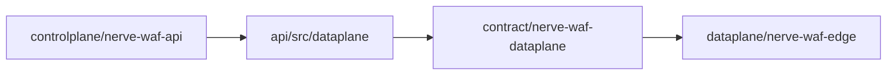

# Nerve-waf Crate 分层

顶层按产品边界分组，crate 名不变（`nerve-waf-*`），仅目录归类。

```text
crates/
├── contract/                  【契约】跨控制面/数据面类型
│   ├── nerve-waf-sdk
│   └── nerve-waf-dataplane    WafEdgeSnapshot
│
├── engine/                    【检测引擎】无 IO、无 Store
│   ├── nerve-waf-core
│   ├── nerve-waf-inspect
│   ├── nerve-waf-l7
│   ├── nerve-waf-plugin-host
│   ├── nerve-waf-plugins
│   ├── nerve-waf-engine
│   ├── nerve-waf-normalize
│   ├── nerve-waf-semantic
│   ├── nerve-waf-coraza
│   ├── nerve-waf-wasm
│   └── nerve-waf-libinjection
│
├── modules/                   【流水线模块】overlay / 策略插件
│   ├── nerve-waf-cc
│   ├── nerve-waf-geo
│   ├── nerve-waf-bot
│   ├── nerve-waf-behavior
│   ├── nerve-waf-whitelist
│   ├── nerve-waf-intel
│   ├── nerve-waf-api-sec
│   ├── nerve-waf-challenge
│   └── nerve-waf-triage
│
├── controlplane/              【控制面】API + Store + 运维
│   ├── nerve-waf-api          src/controlplane + src/dataplane
│   ├── nerve-waf-store
│   ├── nerve-waf-auth
│   ├── nerve-waf-rbac
│   ├── nerve-waf-license
│   ├── nerve-waf-rules-ops
│   ├── nerve-waf-crs-import
│   └── …
│
└── dataplane/                 【数据面进程 / 内嵌运行时】
    ├── nerve-waf-edge         src/dataplane（sync + proxy）
    ├── nerve-waf-embed
    └── nerve-waf-gateway      （占位，Gateway 独立仓库为主）
```



Workspace 路径见仓库根 `Cargo.toml` 的 `members` 与 `[workspace.dependencies]`。

## 测试目录约定

生产代码与测试 **物理分离**：每个 crate 在 `src/test/` 下放 `test_*.rs`，`lib.rs` 末尾仅保留一行挂载：

```rust
#[cfg(test)]
mod test;
```

```text
crates/<layer>/<crate>/
├── src/
│   ├── lib.rs              # 生产逻辑，不含 #[test]
│   ├── snapshot.rs
│   └── test/
│       ├── mod.rs          # mod test_snapshot_contract; …
│       ├── test_snapshot_contract.rs
│       └── test_edge_dataplane_parity.rs
```

- 文件名：`test_<主题>.rs`（对应被测模块或场景）
- 运行：`cargo test -p <crate-name>`
- **不用** crate 根目录 `tests/` 与 `src/` 混放；旧 crate 根 `tests/*.rs` 逐步迁入 `src/test/`
- 源码内 `#[cfg(test)] mod tests { … }` 块逐步迁出，避免与生产逻辑同文件

已按此约定整理：`nerve-waf-dataplane`、`nerve-waf-embed`。其余 crate 后续迁移时沿用同一结构。
